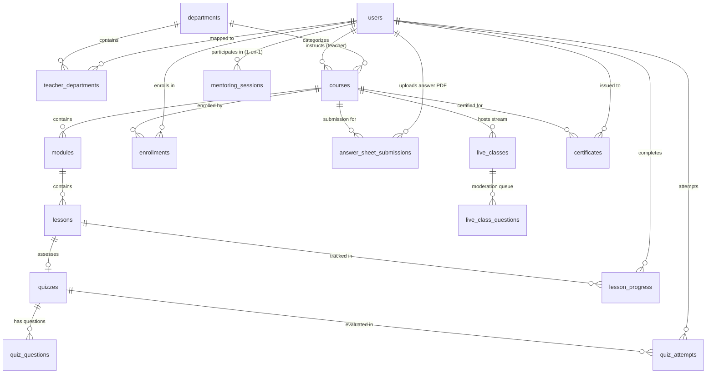

# Nexus LMS — Complete Database Schemas & Architectural Flowcharts
> **Release Version**: 3.2.0 (Enterprise Live Edition)  
> **Database Architecture**: SQLite / PostgreSQL Dual-Compatible  
> **Live Cloudflare URL**: [https://boats-revisions-released-strap.trycloudflare.com](https://boats-revisions-released-strap.trycloudflare.com)  
> **Direct PDF Download**: [https://boats-revisions-released-strap.trycloudflare.com/static/docs/Nexus_LMS_Complete_Schemas_and_Flowcharts.pdf](https://boats-revisions-released-strap.trycloudflare.com/static/docs/Nexus_LMS_Complete_Schemas_and_Flowcharts.pdf)  
> **Direct Postman Collection Download**: [https://boats-revisions-released-strap.trycloudflare.com/static/docs/Nexus_LMS_Postman_Collection.json](https://boats-revisions-released-strap.trycloudflare.com/static/docs/Nexus_LMS_Postman_Collection.json)  

---

## 1. System Topology & Architectural Entity-Relationship Diagram



---

## 2. Core Operational Workflow Diagrams

### 2.1 Multi-Department Faculty Governance & Course Assignment Flow
```mermaid
flowchart TD
    A[Admin opens /department?tab=teachers] --> B[Assign Teacher to Department(s)]
    B --> C[teacher_departments Table Updated]
    C --> D[Admin opens Course Assignment Modal]
    D --> E[GET /api/teachers/{id}/assignable-courses]
    E --> F{Strict Department Verification}
    F -->|Course in Teacher's Department| G[Course Successfully Assigned]
    F -->|Course outside Teacher's Department| H[HTTP 400 Rejected: First Assign Teacher to Department]
    G --> I[Teacher Studio /teacher strictly isolates assigned classes]
```

### 2.2 Subjective Ans Sheet Upload & Administrative Surveillance Flow
```mermaid
flowchart TD
    S1[Student Photographs/Scans Handwritten Solution] --> S2[Upload PDF: POST /api/course/{id}/upload-answer-sheet]
    S2 --> S3[Saved to answer_sheet_submissions & Static Storage]
    S3 --> T1[Instantly appears on Assigned Teacher's Profile /profile]
    S3 --> A1[Instantly visible in Admin Surveillance Window /department?tab=answer-sheets]
    T1 --> T2[Teacher Reviews PDF & Awards Marks / Comments]
    T2 --> T3[Status updated to 'evaluated' with Grade]
    A1 --> A2[Admin monitors 4 Live KPIs: Total, Evaluated, Pending, Completion Rate %]
```

### 2.3 Student 360° Inspection & Portfolio Modal Flow
```mermaid
flowchart TD
    U1[Teacher in Studio / Analytics] --> U2[Click 'View Student Profile' button]
    U2 --> U3[GET /api/students/{id}/profile-modal]
    U3 --> U4[Server fetches Student Demographic & UDISE Metadata]
    U3 --> U5[Server aggregates Enrolled Courses & Completion %]
    U3 --> U6[Server fetches Recent Quiz Assessment History]
    U3 --> U7[Server attaches Uploaded Answer Sheet Copies & Marks]
    U4 & U5 & U6 & U7 --> U8[Unified 360° Student Modal Displayed]
```

---

## 3. Complete Database Schemas (All 24 Relational Tables)

### Table `ai_usage_logs`
*Token metrics, prompt type, latency, and estimated cost tracking for Google Gemini AI*

| # | Column Name | Data Type | Nullability / Key | Default Value |
| :--- | :--- | :--- | :--- | :--- |
| 0 | `id` | `INTEGER` | **PRIMARY KEY** | — |
| 1 | `user_id` | `INTEGER` | NULL | — |
| 2 | `user_name` | `TEXT` | NULL | — |
| 3 | `user_role` | `TEXT` | NULL | — |
| 4 | `course_id` | `INTEGER` | NULL | — |
| 5 | `course_title` | `TEXT` | NULL | — |
| 6 | `subject` | `TEXT` | NULL | — |
| 7 | `feature_type` | `TEXT` | NOT NULL | — |
| 8 | `prompt_tokens` | `INTEGER` | NULL | `0` |
| 9 | `completion_tokens` | `INTEGER` | NULL | `0` |
| 10 | `total_tokens` | `INTEGER` | NULL | `0` |
| 11 | `estimated_cost_usd` | `REAL` | NULL | `0.0` |
| 12 | `created_at` | `TIMESTAMP` | NULL | `CURRENT_TIMESTAMP` |

### Table `answer_sheet_submissions`
*Subjective handwritten PDF uploads, marks awarded, evaluator ID, feedback remarks*

| # | Column Name | Data Type | Nullability / Key | Default Value |
| :--- | :--- | :--- | :--- | :--- |
| 0 | `id` | `INTEGER` | **PRIMARY KEY** | — |
| 1 | `user_id` | `INTEGER` | NOT NULL | — |
| 2 | `course_id` | `INTEGER` | NOT NULL | — |
| 3 | `module_id` | `INTEGER` | NULL | — |
| 4 | `lesson_id` | `INTEGER` | NULL | — |
| 5 | `file_path` | `TEXT` | NOT NULL | — |
| 6 | `original_filename` | `TEXT` | NOT NULL | — |
| 7 | `remarks` | `TEXT` | NULL | — |
| 8 | `status` | `TEXT` | NULL | `'submitted'` |
| 9 | `marks_awarded` | `REAL` | NULL | — |
| 10 | `max_marks` | `REAL` | NULL | `20.0` |
| 11 | `feedback` | `TEXT` | NULL | — |
| 12 | `evaluated_by` | `INTEGER` | NULL | — |
| 13 | `evaluated_at` | `TIMESTAMP` | NULL | — |
| 14 | `created_at` | `TIMESTAMP` | NULL | `CURRENT_TIMESTAMP` |

### Table `audit_logs`
*Security audit trail recording user logins, course modifications, and faculty reassignments*

| # | Column Name | Data Type | Nullability / Key | Default Value |
| :--- | :--- | :--- | :--- | :--- |
| 0 | `id` | `INTEGER` | **PRIMARY KEY** | — |
| 1 | `user_id` | `INTEGER` | NULL | — |
| 2 | `action` | `TEXT` | NOT NULL | — |
| 3 | `entity_type` | `TEXT` | NOT NULL | — |
| 4 | `entity_id` | `TEXT` | NULL | — |
| 5 | `details` | `TEXT` | NULL | — |
| 6 | `created_at` | `TIMESTAMP` | NULL | `CURRENT_TIMESTAMP` |

### Table `certificates`
*Tamper-proof completion credentials, unique identifier, QR code data, and revocation audit*

| # | Column Name | Data Type | Nullability / Key | Default Value |
| :--- | :--- | :--- | :--- | :--- |
| 0 | `id` | `INTEGER` | **PRIMARY KEY** | — |
| 1 | `certificate_id` | `TEXT` | NOT NULL | — |
| 2 | `student_id` | `INTEGER` | NOT NULL | — |
| 3 | `student_name` | `TEXT` | NOT NULL | — |
| 4 | `student_uid` | `TEXT` | NOT NULL | — |
| 5 | `course_id` | `INTEGER` | NOT NULL | — |
| 6 | `course_name` | `TEXT` | NOT NULL | — |
| 7 | `course_code` | `TEXT` | NULL | — |
| 8 | `issued_by` | `TEXT` | NOT NULL | `'Leadership Boulevard Pvt Ltd'` |
| 9 | `issued_at` | `TIMESTAMP` | NULL | `CURRENT_TIMESTAMP` |
| 10 | `status` | `TEXT` | NOT NULL | `'verified'` |
| 11 | `revoked_at` | `TIMESTAMP` | NULL | — |
| 12 | `revocation_reason` | `TEXT` | NULL | — |
| 13 | `reissued_from_id` | `TEXT` | NULL | — |
| 14 | `reissued_to_id` | `TEXT` | NULL | — |
| 15 | `qr_code_data_uri` | `TEXT` | NULL | — |
| 16 | `verification_url` | `TEXT` | NULL | — |
| 17 | `verification_count` | `INTEGER` | NULL | `0` |
| 18 | `last_verified_at` | `TIMESTAMP` | NULL | — |
| 19 | `completion_date` | `TEXT` | NULL | — |
| 20 | `grade_score` | `REAL` | NULL | `100.0` |

### Table `courses`
*Course master catalog, code, assigned teacher_id, department, subject, publication status*

| # | Column Name | Data Type | Nullability / Key | Default Value |
| :--- | :--- | :--- | :--- | :--- |
| 0 | `id` | `INTEGER` | **PRIMARY KEY** | — |
| 1 | `title` | `TEXT` | NOT NULL | — |
| 2 | `code` | `TEXT` | NOT NULL | — |
| 3 | `department` | `TEXT` | NOT NULL | — |
| 4 | `description` | `TEXT` | NULL | — |
| 5 | `thumbnail_url` | `TEXT` | NULL | — |
| 6 | `teacher_id` | `INTEGER` | NOT NULL | — |
| 7 | `is_published` | `INTEGER` | NULL | `1` |
| 8 | `created_at` | `TIMESTAMP` | NULL | `CURRENT_TIMESTAMP` |
| 9 | `subject` | `TEXT` | NULL | — |
| 10 | `status` | `TEXT` | NULL | `'published'` |
| 11 | `archived_at` | `TIMESTAMP` | NULL | — |
| 12 | `deleted_at` | `TIMESTAMP` | NULL | — |
| 13 | `subtitle` | `TEXT` | NULL | — |
| 14 | `learning_path` | `TEXT` | NULL | — |
| 15 | `instructions` | `TEXT` | NULL | — |

### Table `dashboard_permissions`
*Role-based widget access controls for administrative dashboards*

| # | Column Name | Data Type | Nullability / Key | Default Value |
| :--- | :--- | :--- | :--- | :--- |
| 0 | `widget_key` | `TEXT` | **PRIMARY KEY** | — |
| 1 | `widget_title` | `TEXT` | NOT NULL | — |
| 2 | `allowed_roles` | `TEXT` | NOT NULL | — |
| 3 | `is_enabled` | `INTEGER` | NULL | `1` |

### Table `departments`
*Academic buckets, branding, welcome announcement, and ans_writing_enabled toggle*

| # | Column Name | Data Type | Nullability / Key | Default Value |
| :--- | :--- | :--- | :--- | :--- |
| 0 | `id` | `INTEGER` | **PRIMARY KEY** | — |
| 1 | `name` | `TEXT` | NOT NULL | — |
| 2 | `code` | `TEXT` | NOT NULL | — |
| 3 | `description` | `TEXT` | NULL | — |
| 4 | `banner_url` | `TEXT` | NULL | — |
| 5 | `branding_tagline` | `TEXT` | NULL | `'transforming education'` |
| 6 | `welcome_message` | `TEXT` | NULL | — |
| 7 | `created_at` | `TIMESTAMP` | NULL | `CURRENT_TIMESTAMP` |
| 8 | `ans_writing_enabled` | `INTEGER` | NULL | `1` |

### Table `enrollments`
*Student course enrollment registry and completion status*

| # | Column Name | Data Type | Nullability / Key | Default Value |
| :--- | :--- | :--- | :--- | :--- |
| 0 | `id` | `INTEGER` | **PRIMARY KEY** | — |
| 1 | `user_id` | `INTEGER` | NOT NULL | — |
| 2 | `course_id` | `INTEGER` | NOT NULL | — |
| 3 | `enrolled_at` | `TIMESTAMP` | NULL | `CURRENT_TIMESTAMP` |
| 4 | `completed_at` | `TIMESTAMP` | NULL | — |

### Table `lesson_progress`
*Granular lesson completion status and timestamp for student velocity*

| # | Column Name | Data Type | Nullability / Key | Default Value |
| :--- | :--- | :--- | :--- | :--- |
| 0 | `id` | `INTEGER` | **PRIMARY KEY** | — |
| 1 | `user_id` | `INTEGER` | NOT NULL | — |
| 2 | `lesson_id` | `INTEGER` | NOT NULL | — |
| 3 | `is_completed` | `INTEGER` | NULL | `0` |
| 4 | `watched_seconds` | `INTEGER` | NULL | `0` |
| 5 | `completed_at` | `TIMESTAMP` | NULL | — |

### Table `lessons`
*Individual lesson elements (YouTube video, lecture PDF document, or interactive Quiz)*

| # | Column Name | Data Type | Nullability / Key | Default Value |
| :--- | :--- | :--- | :--- | :--- |
| 0 | `id` | `INTEGER` | **PRIMARY KEY** | — |
| 1 | `module_id` | `INTEGER` | NOT NULL | — |
| 2 | `title` | `TEXT` | NOT NULL | — |
| 3 | `content_type` | `TEXT` | NOT NULL | — |
| 4 | `content_value` | `TEXT` | NULL | — |
| 5 | `position` | `INTEGER` | NULL | `1` |
| 6 | `duration_minutes` | `INTEGER` | NULL | `10` |
| 7 | `subtitle` | `TEXT` | NULL | — |
| 8 | `description` | `TEXT` | NULL | — |

### Table `live_class_questions`
*In-stream real-time student doubt submissions with teacher moderation resolution*

| # | Column Name | Data Type | Nullability / Key | Default Value |
| :--- | :--- | :--- | :--- | :--- |
| 0 | `id` | `INTEGER` | **PRIMARY KEY** | — |
| 1 | `live_class_id` | `INTEGER` | NOT NULL | — |
| 2 | `user_id` | `INTEGER` | NOT NULL | — |
| 3 | `user_name` | `TEXT` | NOT NULL | — |
| 4 | `question_text` | `TEXT` | NOT NULL | — |
| 5 | `is_answered` | `INTEGER` | NULL | `0` |
| 6 | `answer_text` | `TEXT` | NULL | — |
| 7 | `created_at` | `TIMESTAMP` | NULL | `CURRENT_TIMESTAMP` |

### Table `live_classes`
*Scheduled, live, and completed streaming sessions with Google Meet/WebRTC URLs*

| # | Column Name | Data Type | Nullability / Key | Default Value |
| :--- | :--- | :--- | :--- | :--- |
| 0 | `id` | `INTEGER` | **PRIMARY KEY** | — |
| 1 | `course_id` | `INTEGER` | NOT NULL | — |
| 2 | `teacher_id` | `INTEGER` | NOT NULL | — |
| 3 | `title` | `TEXT` | NOT NULL | — |
| 4 | `description` | `TEXT` | NULL | — |
| 5 | `platform` | `TEXT` | NOT NULL | `'zoom'` |
| 6 | `meeting_url` | `TEXT` | NOT NULL | — |
| 7 | `meeting_id` | `TEXT` | NULL | — |
| 8 | `meeting_passcode` | `TEXT` | NULL | — |
| 9 | `scheduled_at` | `TIMESTAMP` | NOT NULL | — |
| 10 | `duration_minutes` | `INTEGER` | NULL | `60` |
| 11 | `status` | `TEXT` | NULL | `'scheduled'` |
| 12 | `recording_url` | `TEXT` | NULL | — |
| 13 | `created_at` | `TIMESTAMP` | NULL | `CURRENT_TIMESTAMP` |

### Table `mentoring_sessions`
*1-on-1 faculty counseling appointments, scheduled date/time, Meet link, status, and notes*

| # | Column Name | Data Type | Nullability / Key | Default Value |
| :--- | :--- | :--- | :--- | :--- |
| 0 | `id` | `INTEGER` | **PRIMARY KEY** | — |
| 1 | `initiator_role` | `TEXT` | NOT NULL | — |
| 2 | `student_id` | `INTEGER` | NOT NULL | — |
| 3 | `teacher_id` | `INTEGER` | NULL | — |
| 4 | `course_id` | `INTEGER` | NULL | — |
| 5 | `topic` | `TEXT` | NOT NULL | — |
| 6 | `description` | `TEXT` | NULL | — |
| 7 | `preferred_date` | `TEXT` | NULL | — |
| 8 | `preferred_time` | `TEXT` | NULL | — |
| 9 | `scheduled_date` | `TEXT` | NULL | — |
| 10 | `scheduled_time` | `TEXT` | NULL | — |
| 11 | `meeting_link` | `TEXT` | NULL | — |
| 12 | `status` | `TEXT` | NULL | `'pending_admin_assignment'` |
| 13 | `student_notes` | `TEXT` | NULL | — |
| 14 | `teacher_notes` | `TEXT` | NULL | — |
| 15 | `created_at` | `TIMESTAMP` | NULL | `CURRENT_TIMESTAMP` |
| 16 | `updated_at` | `TIMESTAMP` | NULL | `CURRENT_TIMESTAMP` |

### Table `modules`
*Curriculum units belonging to a course (ordered by position)*

| # | Column Name | Data Type | Nullability / Key | Default Value |
| :--- | :--- | :--- | :--- | :--- |
| 0 | `id` | `INTEGER` | **PRIMARY KEY** | — |
| 1 | `course_id` | `INTEGER` | NOT NULL | — |
| 2 | `title` | `TEXT` | NOT NULL | — |
| 3 | `position` | `INTEGER` | NULL | `1` |
| 4 | `description` | `TEXT` | NULL | — |

### Table `notification_settings`
*User communication preferences for email and in-app alert categories*

| # | Column Name | Data Type | Nullability / Key | Default Value |
| :--- | :--- | :--- | :--- | :--- |
| 0 | `event_type` | `TEXT` | **PRIMARY KEY** | — |
| 1 | `event_title` | `TEXT` | NOT NULL | — |
| 2 | `is_enabled` | `INTEGER` | NULL | `1` |
| 3 | `target_roles` | `TEXT` | NOT NULL | — |

### Table `notifications`
*In-app alerts for course assignments, evaluation completion, and live class reminders*

| # | Column Name | Data Type | Nullability / Key | Default Value |
| :--- | :--- | :--- | :--- | :--- |
| 0 | `id` | `INTEGER` | **PRIMARY KEY** | — |
| 1 | `user_id` | `INTEGER` | NOT NULL | — |
| 2 | `title` | `TEXT` | NOT NULL | — |
| 3 | `message` | `TEXT` | NOT NULL | — |
| 4 | `link_url` | `TEXT` | NULL | — |
| 5 | `category` | `TEXT` | NULL | `'general'` |
| 6 | `is_read` | `INTEGER` | NULL | `0` |
| 7 | `created_at` | `TIMESTAMP` | NULL | `CURRENT_TIMESTAMP` |

### Table `quiz_attempts`
*Student quiz submission records, percentage score, passed/failed boolean, time spent*

| # | Column Name | Data Type | Nullability / Key | Default Value |
| :--- | :--- | :--- | :--- | :--- |
| 0 | `id` | `INTEGER` | **PRIMARY KEY** | — |
| 1 | `user_id` | `INTEGER` | NOT NULL | — |
| 2 | `quiz_id` | `INTEGER` | NOT NULL | — |
| 3 | `score_percent` | `REAL` | NOT NULL | — |
| 4 | `passed` | `INTEGER` | NOT NULL | — |
| 5 | `attempted_at` | `TIMESTAMP` | NULL | `CURRENT_TIMESTAMP` |
| 6 | `started_at` | `TIMESTAMP` | NULL | — |
| 7 | `time_taken_seconds` | `INTEGER` | NULL | `0` |
| 8 | `attempt_data` | `TEXT` | NULL | — |

### Table `quiz_questions`
*Assessment multiple-choice items, options A-D, correct answer key, and pedagogical rationale*

| # | Column Name | Data Type | Nullability / Key | Default Value |
| :--- | :--- | :--- | :--- | :--- |
| 0 | `id` | `INTEGER` | **PRIMARY KEY** | — |
| 1 | `quiz_id` | `INTEGER` | NOT NULL | — |
| 2 | `question_text` | `TEXT` | NOT NULL | — |
| 3 | `option_a` | `TEXT` | NOT NULL | — |
| 4 | `option_b` | `TEXT` | NOT NULL | — |
| 5 | `option_c` | `TEXT` | NOT NULL | — |
| 6 | `option_d` | `TEXT` | NOT NULL | — |
| 7 | `correct_option` | `TEXT` | NOT NULL | — |
| 8 | `explanation` | `TEXT` | NULL | — |

### Table `quizzes`
*Assessment configuration, passing threshold percentage, time limit in minutes*

| # | Column Name | Data Type | Nullability / Key | Default Value |
| :--- | :--- | :--- | :--- | :--- |
| 0 | `id` | `INTEGER` | **PRIMARY KEY** | — |
| 1 | `lesson_id` | `INTEGER` | NOT NULL | — |
| 2 | `passing_score` | `INTEGER` | NULL | `70` |
| 3 | `created_at` | `TIMESTAMP` | NULL | `CURRENT_TIMESTAMP` |
| 4 | `time_limit_minutes` | `INTEGER` | NULL | `10` |

### Table `student_conflicts`
*Conflict resolution queue for handling duplicate national student registrations*

| # | Column Name | Data Type | Nullability / Key | Default Value |
| :--- | :--- | :--- | :--- | :--- |
| 0 | `id` | `INTEGER` | **PRIMARY KEY** | — |
| 1 | `student_name` | `TEXT` | NOT NULL | — |
| 2 | `guardian_name` | `TEXT` | NOT NULL | — |
| 3 | `existing_user_id` | `TEXT` | NOT NULL | — |
| 4 | `requested_data` | `TEXT` | NULL | — |
| 5 | `status` | `TEXT` | NULL | `'pending'` |
| 6 | `created_at` | `TIMESTAMP` | NULL | `CURRENT_TIMESTAMP` |

### Table `support_queries`
*Contextual support tickets, instant Gemini AI suggestions, and faculty resolution*

| # | Column Name | Data Type | Nullability / Key | Default Value |
| :--- | :--- | :--- | :--- | :--- |
| 0 | `id` | `INTEGER` | **PRIMARY KEY** | — |
| 1 | `ticket_id` | `TEXT` | NOT NULL | — |
| 2 | `user_id` | `TEXT` | NOT NULL | — |
| 3 | `user_role` | `TEXT` | NOT NULL | — |
| 4 | `user_name` | `TEXT` | NOT NULL | — |
| 5 | `user_email` | `TEXT` | NULL | — |
| 6 | `course_id` | `INTEGER` | NULL | — |
| 7 | `course_title` | `TEXT` | NULL | — |
| 8 | `subject` | `TEXT` | NOT NULL | — |
| 9 | `category` | `TEXT` | NULL | `'General'` |
| 10 | `message` | `TEXT` | NOT NULL | — |
| 11 | `ai_response` | `TEXT` | NULL | — |
| 12 | `admin_reply` | `TEXT` | NULL | — |
| 13 | `replied_by` | `TEXT` | NULL | — |
| 14 | `replied_at` | `TIMESTAMP` | NULL | — |
| 15 | `status` | `TEXT` | NULL | `'open'` |
| 16 | `visibility` | `TEXT` | NOT NULL | — |
| 17 | `created_at` | `TIMESTAMP` | NULL | `CURRENT_TIMESTAMP` |

### Table `system_settings`
*Global system configurations (branding, Mylo AI toggles, institution name)*

| # | Column Name | Data Type | Nullability / Key | Default Value |
| :--- | :--- | :--- | :--- | :--- |
| 0 | `key` | `TEXT` | **PRIMARY KEY** | — |
| 1 | `value` | `TEXT` | NOT NULL | — |

### Table `teacher_departments`
*Relational link enabling multi-department governance and course assignment verification*

| # | Column Name | Data Type | Nullability / Key | Default Value |
| :--- | :--- | :--- | :--- | :--- |
| 0 | `id` | `INTEGER` | **PRIMARY KEY** | — |
| 1 | `teacher_id` | `INTEGER` | NOT NULL | — |
| 2 | `department_id` | `INTEGER` | NOT NULL | — |
| 3 | `created_at` | `TIMESTAMP` | NULL | `CURRENT_TIMESTAMP` |

### Table `users`
*Primary accounts, auth hash, role (admin/teacher/student), national K-12 data (UDISE, district, guardian)*

| # | Column Name | Data Type | Nullability / Key | Default Value |
| :--- | :--- | :--- | :--- | :--- |
| 0 | `id` | `INTEGER` | **PRIMARY KEY** | — |
| 1 | `user_id` | `TEXT` | NOT NULL | — |
| 2 | `full_name` | `TEXT` | NOT NULL | — |
| 3 | `department` | `TEXT` | NOT NULL | — |
| 4 | `email` | `TEXT` | NULL | — |
| 5 | `password_hash` | `TEXT` | NOT NULL | — |
| 6 | `role` | `TEXT` | NOT NULL | `'student'` |
| 7 | `must_change_password` | `INTEGER` | NULL | `1` |
| 8 | `created_at` | `TIMESTAMP` | NULL | `CURRENT_TIMESTAMP` |
| 9 | `guardian_name` | `TEXT` | NULL | — |
| 10 | `school_name` | `TEXT` | NULL | — |
| 11 | `udise_code` | `TEXT` | NULL | — |
| 12 | `block` | `TEXT` | NULL | — |
| 13 | `district` | `TEXT` | NULL | — |
| 14 | `state` | `TEXT` | NULL | — |
| 15 | `pincode` | `TEXT` | NULL | — |
| 16 | `last_active_at` | `TIMESTAMP` | NULL | — |
| 17 | `normalized_name` | `TEXT` | NULL | — |
| 18 | `normalized_guardian` | `TEXT` | NULL | — |
| 19 | `designation` | `TEXT` | NULL | — |
| 20 | `avatar_url` | `TEXT` | NULL | — |
| 21 | `phone` | `TEXT` | NULL | — |
| 22 | `bio` | `TEXT` | NULL | — |
